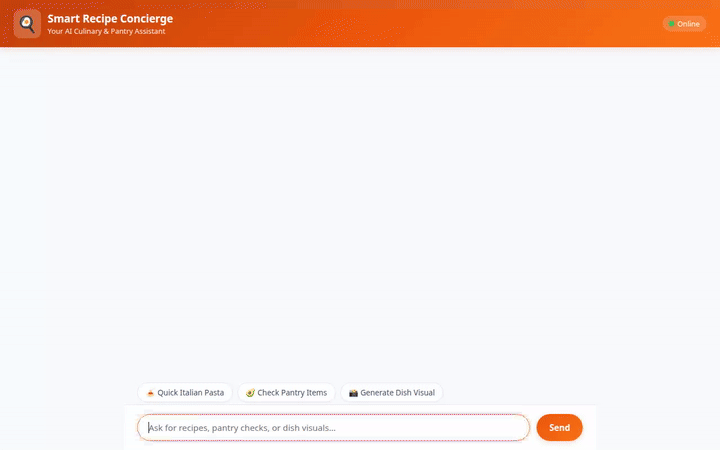

# 🍳 Smart Recipe Concierge

An intelligent, multi-tool culinary and pantry management AI agent powered by Google's **Agent Development Kit (ADK)** and deployed on **Agent Platform / Agent Engine**.



---

## 🌟 Features & Implemented Capabilities

The **Smart Recipe Concierge** combines database queries, external APIs, generative AI models, and dynamic code execution to help users discover, scale, and visualize delicious meals.

### 🧠 1. Long-Term Cross-Session Memory
- **Vertex AI Memory Bank**: Integrates `PreloadMemoryTool` and automated memory-generation callbacks to remember user dietary preferences, food allergies, and cooking goals across separate chat sessions.

### 📦 2. Firestore Pantry & Recipe Store
- **Local Pantry Lookup (`get_pantry_items`)**: Queries Google Cloud Firestore to check available ingredients in the user's kitchen.
- **Local Recipe Catalog (`get_local_recipes`)**: Fetches curated house recipes directly from Firestore collections.

### 🌐 3. External Culinary API Search
- **TheMealDB Integration (`search_external_recipes`)**: Connects to external food APIs to retrieve diverse international recipes whenever local Firestore options are limited.

### 🧮 4. Dynamic Python Code Execution
- **Recipe Scaling (`scale_recipe_ingredients`)**: Runs Python code to dynamically recalculate ingredient quantities and nutrition macros when users scale serving sizes (e.g., 2 to 4 people).

### 🎨 5. AI Food Image Generation
- **Vertex AI Imagen (`generate_dish_image`)**: Utilizes `gemini-3.1-flash-lite-image` to generate high-resolution food photography for suggested recipes.

### 🎬 6. Google Omni AI Video Generation
- **Omni Model (`generate_recipe_video`)**: Leverages `gemini-omni-flash-preview` in the `global` region to generate 720p cooking demonstration videos.
- **Dual Output**: Automatically saves video artifacts via `tool_context.save_artifact` and uploads raw MP4 bytes to a public Google Cloud Storage bucket.

### 🎛️ 7. Rich Display Cards (A2UI)
- **A2UI Protocol**: Formats agent responses with rich cards, tables, and images for seamless display in ADK Web and custom frontends.

---

## 🚧 Planned & Future Capabilities

The following features were outlined in initial design briefs and are marked for future releases:
- 🛒 **Direct Grocery Cart Integration**: Auto-ordering missing ingredients via supermarket APIs *(Planned, not yet implemented)*.
- 🧊 **Smart Fridge IoT Sync**: Real-time ingredient tracking via smart appliance sensors *(Planned, not yet implemented)*.

---

## 🛠️ Local Development & Running Instructions

### Prerequisites
- Python 3.10+
- Google Cloud SDK (`gcloud`) with access to an active GCP project
- Enabled APIs: Vertex AI, Firestore, Cloud Storage

### 1. Agent Setup
```bash
# Clone the repository and navigate to the project directory
cd smart-recipe-concierge

# Install agent dependencies
pip install -r app/requirements.txt
```

### 2. Frontend Setup
```bash
# Navigate to the frontend directory
cd frontend

# Install frontend proxy dependencies
pip install -r requirements.txt
```

### 3. Run the Frontend Proxy Locally
Set your deployed Agent Engine resource name and start the FastAPI proxy server:

```bash
export AGENT_ENGINE_RESOURCE_NAME="projects/<PROJECT_ID>/locations/<REGION>/reasoningEngines/<RESOURCE_ID>"
export AGENT_DIRECTORY="app"
export PORT=8080

python main.py
```

Once running, navigate your web browser to `localhost` on port `8080` to interact with your Smart Recipe Concierge!
